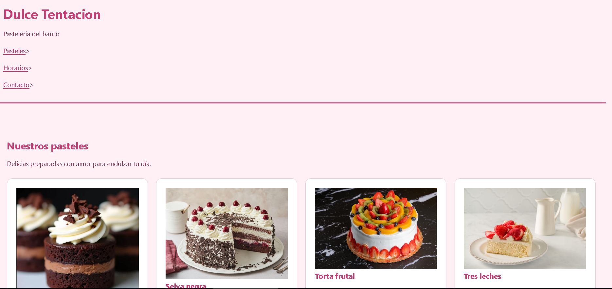

# [Dulce Tentacion]

**Estudiante:** [Amalia Patty Churqui]
**Cliente:** [Pasteleria , Dulce Tentacion]
**URL publicada:** [DESPUES, PROXIMA SEMANA]

## Qué resuelve
[2-3 frases: qué problema tiene tu cliente y cómo lo ayuda este sitio.
El proyecto Pastelería Dulce Tentación consiste en una página web creada para presentar los productos de una pastelería, como tortas, pasteles . El sitio permite que los clientes conozcan los productos de manera visual y encuentren información del negocio de forma rápida y sencilla. Su objetivo es mejorar la presentación del negocio y atraer a más clientes a través de Internet.]

## Cómo está construido
- **Semántica:** [qué elementos usaste y dónde.
Utilicé HTML para organizar el contenido de la página y CSS para darle estilo. Empleé elementos como header para la cabecera, nav para el menú de navegación, main para el contenido principal, section para organizar las secciones de productos y footer para el pie de página.]
- **Layout:** [dónde Flexbox, dónde Grid, y por qué. 
Utilicé Flexbox para organizar elementos como el menú de navegación y alinear el contenido. También utilicé Grid para distribuir las imágenes de tortas y pasteles en filas y columnas, para una presentación ordenada de los productos.]
- **Diseño:** [paleta y tipografía, y por qué las elegiste.
 Elegí colores rosados, blancos y tonos suaves, relacionados con pastelería, para transmitir dulzura, elegancia . Utilicé una tipografía legible para facilitar la lectura y conseguir que la página sea agradable para los visitantes.]

## Capturas

 DESPUES, PROXIMA SEMANA

## Lo más difícil
[Qué problema técnico te costó más y cómo lo resolviste. Sé específico:
"el menú se salía de la pantalla en móvil y lo resolví con flex-wrap"
vale; "fue difícil pero lo logré" no vale.
Una de las partes más difíciles fue organizar los elementos de la página para que las imágenes de los pasteles y el contenido se vieran ordenados y atractivos. También fue importante adaptar el diseño para que pudiera visualizarse correctamente en diferentes tamaños de pantalla. Para solucionarlo, utilicé propiedades de CSS para controlar la distribución, el tamaño y la separación de los elementos, procurando mantener una presentación clara y organizada.]