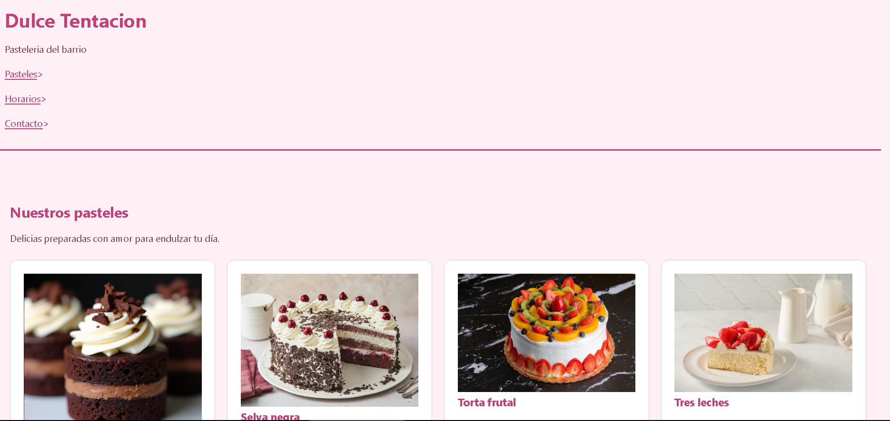

# Dulce Tentación — Pastelería Artesanal del Barrio

**Estudiante:** Amalia Patty Churqui  
**Cliente:** Pastelería Dulce Tentación  
**URL publicada:** *(Próximamente)*

---

## Qué resuelve
Mi cliente (**Pastelería Dulce Tentación**) tenía el problema de no contar con una vitrina digital donde mostrar todos sus pasteles con sus precios, stock y fotografías reales. Con este sitio web los clientes pueden explorar el catálogo de forma rápida, buscar y filtrar por categoría, armar su carrito de compras con cálculo de envío gratis o hacer un pedido programado directamente.

## Cómo está construido
- **Semántica (`index.html`):** Se utilizó `<header>` para la identidad de marca y barra de navegación, `<main>` para el contenido principal, `<section>` para organizar cada bloque funcional (vitrina hero, catálogo de productos, carrito de compras, formulario de pedidos, horarios, ubicación, catálogo del proveedor y panel de preguntas frecuentes), `<article>` para cada tarjeta de pastel, `<aside>` para notas informativas y `<footer>` con `<address>` para los datos de contacto.
- **Layout (`estilos.css`):**
  - **CSS Grid:** Maquetación de tienda en dos columnas (`.tienda-principal`: catálogo de pasteles a la izquierda y carrito/tablero de compra a la derecha), además de grillas responsivas (`repeat(auto-fit, minmax(...))`) para las tarjetas de productos y el catálogo de proveedores.
  - **Flexbox:** Alineación de la barra superior de preferencias, encabezado, controles de búsqueda/filtros, barra de progreso de envío e interior de las tarjetas y fichas del carrito.
- **Diseño e Imágenes (`img/`):** Paleta en tonos rosa frambuesa (`#c83270` y `#e95791`) y crema rosado (`#fff3f7`) acorde a la identidad de una pastelería artesanal, con soporte completo para **Modo oscuro** (`.tema-oscuro`) y todas las fotografías de productos organizadas dentro de la carpeta `img/`.

## Capturas

## Lo más difícil
Lo más retador fue organizar el layout de la tienda para que los productos queden a la izquierda y el carrito de compras interactivo al lado derecho, sincronizando el arrastre de tarjetas (*Drag & Drop*), los botones de compra directa, el cálculo de envío gratis y la transferencia automática de los productos al formulario de pedido.

---

## Laboratorio 2
En el **Laboratorio 2** se incorporó la lógica dinámica con **JavaScript Vanilla (ES6+)** para transformar la página estática en un catálogo interactivo:
- **`app.js` y `funciones.js`:** Declaración de constantes y variables del negocio, manejo de tipos, *template literals*, funciones flecha, *callbacks* y *closures*, además del aviso dinámico de stock en el encabezado (`#aviso-stock`).
- **`datos.js`:** Estructuración del catálogo de pasteles en un arreglo de objetos (`nombre`, `precio`, `categoria`, `stock`, `disponible`, `imagen` en la carpeta `img/` y `descripcion`), junto con el uso de métodos de arreglo (`forEach`, `map`, `filter`, `find`, `some`, `every`, `sort`, `reduce`) y clases (`Producto` y `ProductoConDescuento`).
- **`render.js`:** Generación dinámica de las tarjetas de pasteles en el DOM dentro de `#lista-productos`, reemplazando el HTML escrito a mano y aplicando la clase `.agotado` cuando corresponde.
- **`eventos.js`:**
  - **Buscador en tiempo real (`input`):** Filtra los pasteles por nombre a medida que el cliente escribe.
  - **Filtros por categoría (`click` con delegación de eventos):** Permite alternar entre *Todos*, *Pastel*, *Chocolate*, *Frutal* y *Dulce*, actualizando el contador de resultados.
  - **Validación del formulario de pedido (`submit`):** Uso de `preventDefault()`, `reportValidity()` y `setCustomValidity()` para validar que la fecha de entrega no sea anterior al día actual.

---

## Laboratorio 3
En el **Laboratorio 3** se integraron **jQuery**, **peticiones asíncronas (`fetch` y `JSON`)**, **almacenamiento local (`localStorage`)**, **geolocalización** y un **tablero interactivo de carrito de compras (`Drag & Drop`)**:
- **jQuery y Panel Interactivo (`jquery-3.7.1.min.js`, `jquery-comparado.js` y `jquery-panel.js`):**
  - Sección comparativa entre JavaScript Vanilla y jQuery para destacar las especialidades y promociones de la pastelería.
  - Menú rápido desplegable (`#menu-toggle` con `.slideToggle()`), acordeón exclusivo de preguntas frecuentes (`#acordeon`), avisos de horneado con aparición escalonada (`.each()` + `.delay()` + `.fadeIn()`), descarte individual con `.fadeOut()` y desplazamiento suave (*smooth scroll*) con `.animate()`.
- **Catálogo Remoto del Proveedor (`datos.json` y `remoto.js`):**
  - Carga asíncrona de los 16 productos e insumos desde `datos.json` utilizando tanto `fetch` con `async/await` como `$.getJSON` de jQuery, mostrando los estados visuales de red (`cargando`, `ok` y `error` al probar una ruta inexistente).
- **Preferencias al Inicio y Geolocalización (`preferencias.js`):**
  - Barra de preferencias ubicada al inicio de la página que guarda en `localStorage` (`pasteleria:preferencias`, protegido con `try/catch`) el **Modo oscuro / claro** y el criterio de **ordenamiento del catálogo** (*Nombre*, *Precio* o *Stock*), además del botón para olvidar las preferencias.
  - Cálculo de la distancia en kilómetros desde la ubicación del cliente hasta la pastelería mediante `navigator.geolocation.getCurrentPosition()` y la fórmula de Haversine.
- **Tienda y Carrito de Compras Interactivo (`tablero.js`):**
  - Interfaz de compra con los productos a la izquierda y el **Carrito y Tablero de Pedido** a la derecha.
  - Soporte completo para **Drag & Drop** nativo (arrastrando pasteles desde el catálogo o entre las secciones *Mi carrito*, *Vitrina rápida* y *Para encargo*), botones de cantidad (`+` y `−`), compra directa desde la vitrina superior, **calculadora de envío con barra de progreso animada** hacia el envío gratis y botón para transferir el carrito directamente al formulario de pedido programado.
